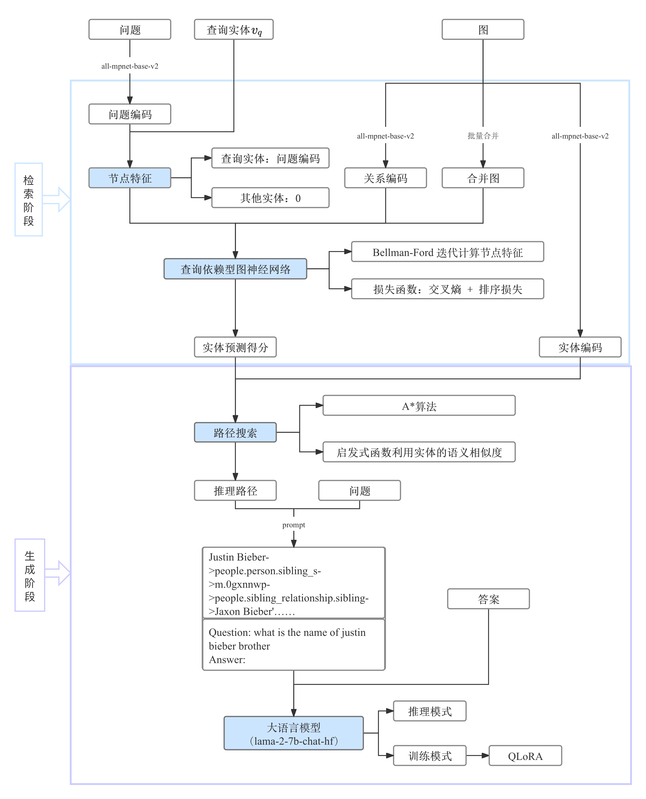

# TAG-RAG：文本属性图检索增强生成

面向知识图谱问答，将文本属性图检索与大语言模型生成结合，利用实体关系和推理路径为回答提供结构化知识。包含 WebQSP 与 MetaQA 数据集上的训练、推理代码。

## 整体框架



1. **实体检索**：编码问题与图中的关系，通过查询依赖型图神经网络传播问题语义，对候选实体评分。
2. **路径构建**：在图中搜索查询实体到候选实体的连接路径，构造结构化推理线索。
3. **答案生成**：将问题与推理路径组成输入，结合 Llama 2 和 QLoRA 微调生成回答。

## 代码结构

```text
config/                     实验配置
my_datasets/                WebQSP、MetaQA 数据加载与预处理
ultra/                      图神经网络及 C++/CUDA 扩展
models.py / losses.py       检索模型与损失函数
fine_tuning.py              检索器训练
path_generate.py            推理路径搜索
llm.py                      大语言模型与 QLoRA
train_llm*.py               生成模型训练
inference*.py               问答推理
```

框架图展示方法设计；当前代码同时保留实体输入与路径输入实验分支，部分接口仍需对齐。仓库仅包含源码、配置和文档，数据与模型权重需另行准备；尚未完成全新环境下的端到端复现。运行环境及已知问题见 [项目检查报告](docs/PROJECT_AUDIT.md)。
